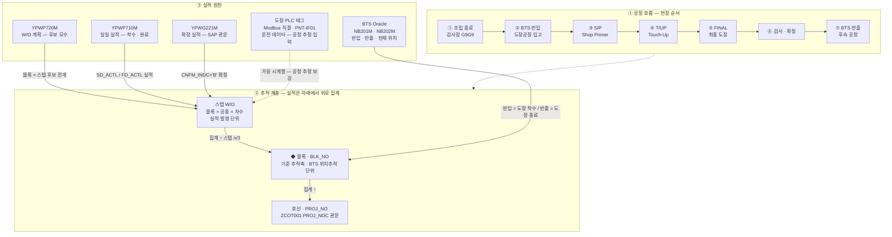
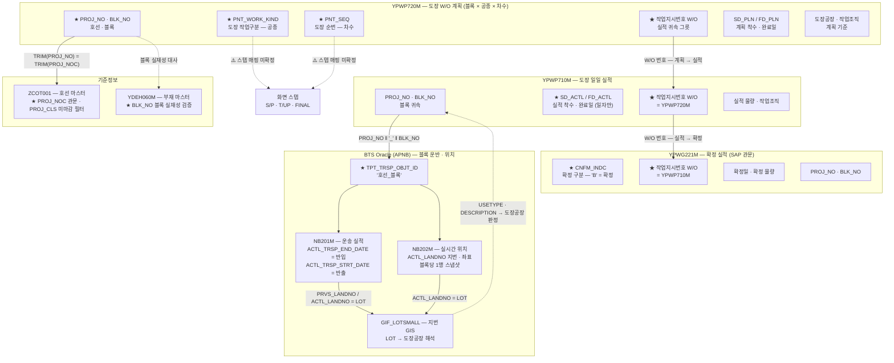
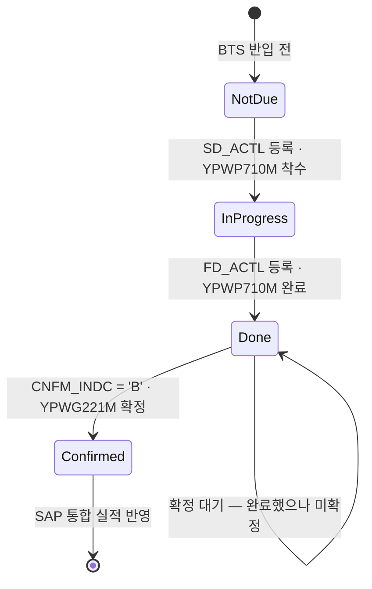
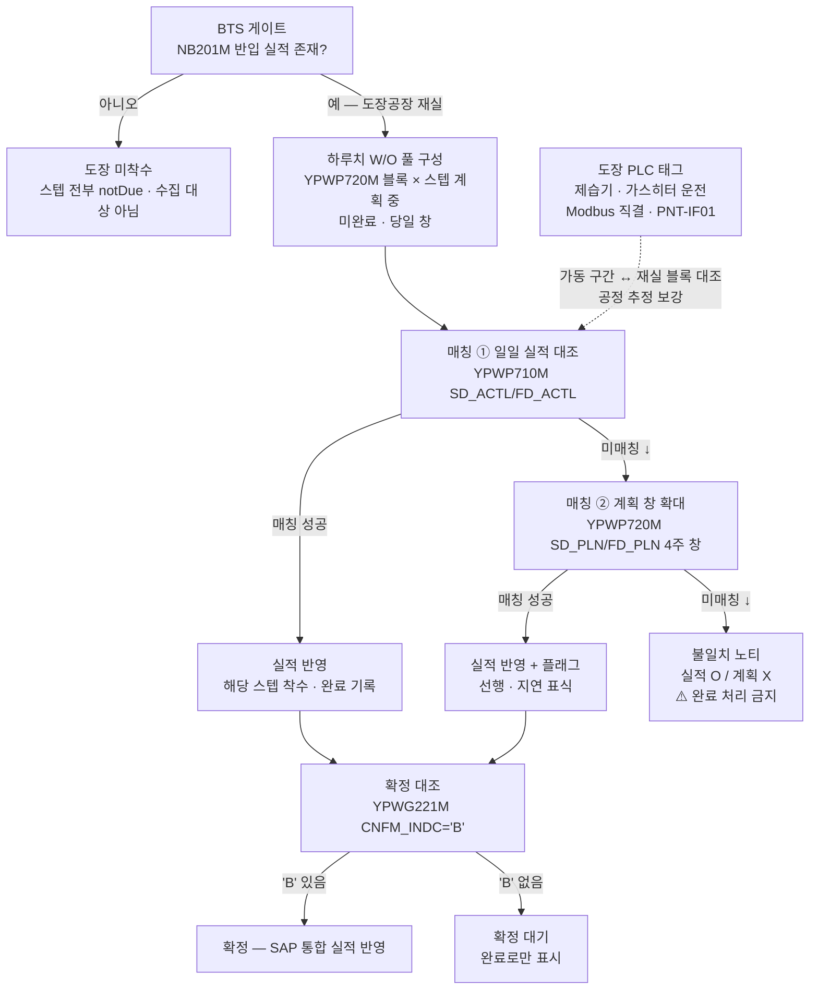

# 내업 공정실적 자동수집 시스템
# 선행도장권역 Legacy 데이터플로우

**버전:** v0.7
**작성:** 이태훈 PM
**소속:** 한화에너지 컨버전스사업부 R&D센터 솔루션개발1팀

---

## 목차

1. [개요](#1-개요)
2. [공정 흐름과 추적 계층](#2-공정-흐름과-추적-계층)
3. [키체인 상세 — 도장 3테이블](#3-키체인-상세--도장-3테이블)
4. [BTS 물류 기반 도장공장 귀속](#4-bts-물류-기반-도장공장-귀속)
5. [확정 관문 — CNFM_INDC='B'](#5-확정-관문--cnfm_indcb)
6. [실적 수집 사이클](#6-실적-수집-사이클)
7. [처리 원칙 · 주의](#7-처리-원칙--주의)
8. [미확정 항목](#8-미확정-항목)

---

## 1. 개요

본 문서는 선행도장권역의 **레거시 데이터플로우** — 즉 블록 하나가 도장공장에 반입되어 S/P → T/UP → FINAL 스텝을 통과하고 SAP 확정 실적으로 마감되기까지, 어느 테이블의 어느 키가 그 사실을 들고 있는지를 정의한다. 대상 독자는 판별 서비스(`ot-pipeline-painting`)·통합실적대시보드·Key-in 실적 시스템의 개발자와, 레거시 연동 인터페이스를 설계하는 담당자다.

형제 문서인 「가공권역 Legacy 데이터플로우」(`가공권역_dataflow.drawio`)·「조립권역 데이터플로우」(`조립권역_dataflow.drawio`)와 같은 구성 — ① 계층 추적 → ② 키체인 상세 → ③ 수집 사이클 — 을 따르되, 도장권역은 draw.io 원본 대신 Mermaid로 직접 작성한다.

### 1.1 다른 권역과 구별되는 점

| 항목 | 도장권역 | 비교 |
|---|---|---|
| 기준 추적축 | **블록(`BLK_NO`)** | 가공=부재(`PART_NO`), 조립=어셈블리(`ASSY_NO`) |
| 절점 성격 | 스텝이 **진짜 순차 절점** (S/P → T/UP → FINAL) | 조립의 소조·중조·대조는 절점이 아닌 ASSY 계층 |
| 위치 기준 | BTS 물류 실적(반입·반출) — 도장공장 귀속 | 조립은 정반(`JIG_CODE`) 기준 |
| 필드 수집 | PLC 운전 데이터(Modbus 직결, MQTT 미경유) — `PNT-IF01` | 조립·의장은 LiDAR → MQTT Broker |
| 마감 | SAP 확정 실적 관문(`CNFM_INDC='B'`) 통과가 곧 실적 마감 | 조립은 W/O 완료가 마감 |

> **참고:** 필드 PLC 태그(제습기·가스히터 운전 데이터)는 **공정 추정의 입력**이지 스텝 실적 그 자체가 아니다. 태그 설계는 「필드 데이터 수집 메시지 설계 v0.2」 §3-도장이 다루며, 본 문서는 **레거시 실적 축**만 다룬다. 두 축은 블록 귀속(BTS 입출고 대조)에서 만난다.

### 1.2 레거시 명세 검증 상태

도장 3테이블(`YPWP720M`·`YPWP710M`·`YPWG221M`)의 테이블·필드 명세는 **SE12 검증을 완료하였다(2026-09-02)**. 따라서 본 문서의 테이블 구조·키 구성·관문 조건은 확정 사실로 기술한다.

스텝 축(S/P·T/UP·FINAL ↔ 레거시 키)은 SE12 명세가 아니라 **`YPWP720M` 실데이터 3,996행에서 유도**하였다(2026-09-03) — §3.3. 매핑은 `apps/ot-dashboard/src/shared/features/performance/api/paintingStepMapping.ts` **한 곳**에만 두고, 현업 공식 확정이 오면 그 파일만 고친다.

> **참고:** 유도에 쓴 원본 CSV는 사외 실데이터라 레포에 두지 않는다. 분석 스크립트와 분포표는 `.work/`(비커밋)에 있고, 결론과 대표 표본만 문서·테스트(`paintingStepMapping.test.ts`)로 옮겼다.

---

## 2. 공정 흐름과 추적 계층

블록은 조립 종료(검사장 G9G9 이동) 후 BTS로 도장공장에 반입되고, 도장공장 안에서 스텝 단위 W/O를 순차 통과한 뒤 반출된다. 실적은 **스텝 → 블록 → 호선**으로 롤업된다.



*그림 1. 선행도장권역 계층 추적 데이터플로우*

| 계층 | 키 | 의미 |
|---|---|---|
| 스텝 W/O | 작업지시번호 + `PNT_WORK_KIND` + `PNT_SEQ` | 실적이 붙는 그릇. 블록 하나에 스텝 수만큼 존재 |
| 블록 | `PROJ_NO` + `BLK_NO` | **기준 추적축.** BTS 위치추적 단위와 동일 |
| 호선 | `PROJ_NO` (↔ `ZCOT001.PROJ_NOC`) | 집계 목표. 미마감 공사 필터 |

> **참고:** 도장에는 조립의 어셈블리(`ASSY_NO`)에 해당하는 중간 계층이 없다. 도장은 블록이 완성된 뒤의 공정이므로 **블록이 곧 최소 실적 단위**이며, 그 아래로 내려가지 않는다.

---

## 3. 키체인 상세 — 도장 3테이블

계획 → 일일 실적 → 확정 실적의 3단 구조다. 앞 단계 없이 뒤 단계만 존재할 수 없고, 확정(`YPWG221M`)은 반드시 일일 실적(`YPWP710M`)을 선행 조건으로 갖는다.



*그림 2. 도장권역 키체인 상세 — 3테이블 + BTS + 기준정보*

### 3.1 조인 체인 요약

| 구간 | 조인 키 | 성격 |
|---|---|---|
| 계획 → 일일 실적 | `YPWP720M` 작업지시번호 = `YPWP710M` 작업지시번호 | ★ 핵심. 1 : N (일자별 실적 다건 가능) |
| 일일 실적 → 확정 | `YPWP710M` 작업지시번호 = `YPWG221M` 작업지시번호 | ★ 핵심. 확정은 실적 뒤에만 온다 |
| 실적 → BTS | `PROJ_NO ‖ '_' ‖ BLK_NO` = `TPT_TRSP_OBJT_ID` | 블록 귀속·위치 |
| BTS → 도장공장 | `ACTL_LANDNO` = `GIF_LOTSMALL.LOT` | 지번 → 공장 해석 |
| 계획 → 호선 | `TRIM(PROJ_NO)` = `TRIM(ZCOT001.PROJ_NOC)` | 관문(미마감 공사만) |

### 3.2 키 필드 속성

- **`PNT_WORK_KIND`(공종 구분)** — `'P'`(도장) / `'C'`(전처리) **2값뿐**이다. 전처리 공종은 작업준비·블라스팅·GRIT수거·검사·TAPE설치를 담고, 화면 스텝은 전부 `'P'` 쪽에서만 나온다.
- **`ELMT_ITEM_CODE`(요소 코드)** — **스텝 축**이다. `S1`~`S6`=S/P(1)~S/P(6), `U1`·`U2`=T/UP(1)·T/UP(2), `R0`=RE-S/P 또는 작업준비, `Q0`=FINAL 또는 검사, `T0`=TAPE제거 또는 TAPE설치, `B0`=블라스팅, `G0`=GRIT수거. `R0`·`Q0`·`T0`이 두 공종에 겹치므로 **(`PNT_WORK_KIND`, `ELMT_ITEM_CODE`) 쌍**이라야 상세공정과 1:1이 된다(§3.3).
- **`PNT_SEQ`(도장 순번)** — **스텝 축이 아니다.** 같은 (호선·블록·존·W/O·상세공정코드) 안에서 최대 6개까지 값이 갈리므로 **반복 회차**로 읽어야 한다(§3.3).
- **`PNT_DETL_PRCS_CD`(상세공정 코드, 8자)** — `PNT_WORK_KIND` ‖ `MAJ_CODE` ‖ `STRC_SPCL_CODE` ‖ `PNT_PRCS_SEQ` ‖ `ELMT_ITEM_CODE` 의 합성이다(3,996행 전건 일치). 이 코드 하나만 있어도 첫 자리로 공종을, 끝 2자리로 요소코드를 얻어 스텝을 판별할 수 있다.
- **`PNT_PRCS_SEQ`(공정 순번)** — 사양 안에서의 실행 순서. 사양별 시퀀스를 복원하는 축이다(§3.3).
- **`SD_ACTL` / `FD_ACTL`(실적 착수·완료일)** — **일자 단위**다. 시각(HH:MM)이 없으므로 도장 스텝 이벤트는 일자만 표시하고, 시각이 필요한 절점(BTS 반입·반출)은 BTS 실적에서 가져온다.
- **`CNFM_INDC`(확정 구분)** — `'B'` 가 확정. §5 참조.
- **`TPT_TRSP_OBJT_ID`** — BTS의 블록 식별자. `'호선_블록'` 문자열 결합 형식이다.

> **참고:** 테이블·컬럼의 **확정 매핑 명세는 「레거시 인터페이스 정의서」(`docs/interface/레거시인터페이스정의서.md`) 소관**이다. 본 문서는 데이터가 흐르는 경로와 조인 축을 정의하고, 컬럼 단위 자료형·PK 명세는 그 문서를 따른다.
> 도장 4테이블(`YPWP720M`·`YPWP710M`·`YPWG221M`·`YPWG413M`)은 「레거시 인터페이스 정의서」 **§8** 에 편입되었다(2026-09-10). 취득 채널은 「인터페이스 정의서」 **`PNT-IF02`** 다. ⚠️ 컬럼 명세 원본(「Legacy SAP 테이블·필드 정리(도장)」)이 레포에 없어 그 문서에는 본 문서에 명시된 컬럼만 등재되어 있다.

### 3.3 스텝 판별 규칙 — `YPWP720M` 실데이터 유도 (2026-09-03)

화면 3스텝(S/P → T/UP → FINAL)이 레거시의 어느 컬럼에 붙는지를 `YPWP720M` **실데이터 3,996행**으로 유도하였다. 결론은 **스텝 축이 `ELMT_ITEM_CODE`이고, `PNT_WORK_KIND`가 그 동음이의를 가른다**는 것이다.

**(`PNT_WORK_KIND`, `ELMT_ITEM_CODE`) 16개 조합 — `PNT_DETL_PRCS_NM`과 1:1**

| 공종 | 요소코드 | 상세공정명 | 스텝 귀속 | 행수 | 비율 |
|---|---|---|---|---|---|
| `P` | `S1` | S/P(1) | **S/P** | 388 | 9.7% |
| `P` | `S2` | S/P(2) | **S/P** | 261 | 6.5% |
| `P` | `S3` | S/P(3) | **S/P** | 135 | 3.4% |
| `P` | `S4` | S/P(4) | **S/P** | 75 | 1.9% |
| `P` | `S5` | S/P(5) | **S/P** | 11 | 0.3% |
| `P` | `S6` | S/P(6) | **S/P** | 6 | 0.2% |
| `P` | `U1` | T/UP(1) | **T/UP** | 272 | 6.8% |
| `P` | `U2` | T/UP(2) | **T/UP** | 90 | 2.3% |
| `P` | `R0` | RE-S/P | **T/UP** (판단 — 아래) | 388 | 9.7% |
| `P` | `Q0` | FINAL | **FINAL** | 388 | 9.7% |
| `P` | `T0` | TAPE제거 | 부대 | 388 | 9.7% |
| `C` | `R0` | 작업준비 | 부대(전처리) | 308 | 7.7% |
| `C` | `B0` | 블라스팅 | 부대(전처리) | 308 | 7.7% |
| `C` | `G0` | GRIT수거 | 부대(전처리) | 308 | 7.7% |
| `C` | `Q0` | 검사 | 부대(전처리) | 335 | 8.4% |
| `C` | `T0` | TAPE설치 | 부대(전처리) | 335 | 8.4% |

| 분류 | 행수 | 비율 |
|---|---|---|
| 스텝(S/P 876 · T/UP 750 · FINAL 388) | 2,014 | **50.4%** |
| 부대(전처리 1,594 · TAPE제거 388) | 1,982 | 49.6% |
| **미분류** | **0** | **0.0%** |

**사양별 공정 시퀀스 (`PNT_PRCS_SEQ` 순, 20개 사양)**

| 사양 수 | 시퀀스 |
|---|---|
| 8 | S/P(1) → T/UP(1) → RE-S/P → FINAL → TAPE제거 |
| 7 | 작업준비 → 블라스팅 → GRIT수거 → 검사 → TAPE설치 (전처리 `C`) |
| 5 | S/P(1) → T/UP(1) → S/P(2) → T/UP(2) → RE-S/P → FINAL → TAPE제거 |
| 각 1 | S/P 차수·T/UP 차수만 늘어난 8종 변형 (최대 S/P(6)까지) |

도장 사양 13종 전부가 `… → RE-S/P → FINAL → TAPE제거`로 끝난다. T/UP은 13종 중 7종에만 있다.

**유도된 규칙**

1. `PNT_WORK_KIND != 'P'` → 스텝 아님(전처리 부대 작업).
2. `ELMT_ITEM_CODE ∈ {S1…S6}` → **S/P**. 차수는 도막 층수이지 별도 절점이 아니므로 한 스텝으로 집계한다.
3. `ELMT_ITEM_CODE ∈ {U1, U2, R0}` → **T/UP**.
4. `ELMT_ITEM_CODE = Q0` → **FINAL** (공종 `C`의 `Q0`는 '검사'이므로 공종 검사가 선행되어야 한다).
5. 그 밖의 (`P`, `T0`)와 공종 `C` 전부 → 부대 작업. 절점 카드에 세지 않는다.
6. 위 어디에도 없는 조합 → **`unknown`**. 유도 시점 0건이므로, 실연동에서 나오면 새 코드값이 생긴 것으로 보고 **완료 처리하지 않고 정합성 이슈로 올린다**(§6.1 불일치 노티와 같은 취급).

> ⚠️ **판단이 하나 들어갔다 — RE-S/P의 귀속.** 이름은 S/P 계열이지만 사양 시퀀스에서 항상 **T/UP 뒤·FINAL 앞**에 오고 도장 사양 13종 전부가 1회씩 갖는 최종 보수 단계다. 순차 절점 모델에서는 순서 정합이 이름보다 중요하므로 **T/UP에 귀속**시켰다. 이름 기준으로 되돌리려면 `paintingStepMapping.ts`의 `TUP.elmtItemCodes`에서 `'R0'`을 `SP` 쪽으로 옮기면 된다(§8 #1).

**그레인·커버리지 (같은 3,996행)**

| 관측 | 값 | 화면 모델에 대한 함의 |
|---|---|---|
| 블록 수 | 20 (전부 3스텝 보유) | 블록 단위 3스텝 절점 모델이 데이터로 성립한다 |
| 스텝 행이 있는 W/O | 77건 — 1스텝 28 · 2스텝 37 · 3스텝 12 | **스텝 : W/O 는 1:1이 아니다.** 화면의 '스텝별 W/O 1건' 표기는 더미의 단순화이며, 실연동에서는 스텝별로 W/O가 여러 건이거나 한 W/O가 여러 스텝을 덮는다 |
| 행 그레인 | `PROJ_NO`+`BLK_NO`+`PNT_ZONE_CODE`+`PNT_WORK_KIND`+`PNT_SEQ`+`ELMT_ITEM_CODE`+`IN_OUT_SIDE_CLSF`+`WORK_ORD_NO` (중복 0) | 스텝 하나가 **존·내외(`I`/`O`)·회차**로 여러 행에 흩어진다 — 스텝 완료 판정은 이 행들의 집계여야 한다 |
| `SD_PLN`/`FD_PLN` 채움률 | 100% | 계획은 전건 존재 |
| `SD_ACTL`/`FD_ACTL` 채움률 | 23.6% | 실적은 진행분만 — 미착수 스텝이 다수인 정상 상태 |

### 3.4 스텝 집계 규칙 — 존재 기반(existence-based)

> **확정(2026-09-03, 사용자):** 스텝 모델은 **고정 3단 사다리가 아니다.** 스텝이 몇 개인지도, 한 스텝의 분모가 몇 행인지도 **그 블록의 계획(`YPWP720M`)이 정한다.**

| 규칙 | 내용 |
|---|---|
| 스텝 존재 | 블록의 스텝 목록 = **계획 행이 있는 스텝만.** 계획 행이 0인 스텝은 목록에서 뺀다 — 없는 스텝을 분모에 넣으면 영영 채워지지 않는다 |
| RE-S/P(`R0`) | **이벤트성.** 계획에 `R0` 행이 있을 때만 T/UP 분모에 포함하고, 없으면 아예 세지 않는다 |
| S/P 회차(`S1`~`S6`) | 마찬가지로 **그 블록에 실제 계획된 회차만** 분모에 든다 — 모든 블록이 전 회차를 돌지 않는다 |
| 스텝 분모 | 그 스텝으로 분류된 **계획 행 전부** (회차 × 존 × 내외로 흩어진 행을 모두 포함). **존 코드별로 나누지 않고 스텝 하나로 통합 관리**한다 — 현업 합의(2026-09-03 회의) |
| 스텝 완료 | **계획 행 전량 완료**(`FD_ACTL` 전건). 부분 완료는 **진행중**이지 완료가 아니다 |
| 진행률 | 완료 행 ÷ 계획 행 |
| 요약 분모 | '스텝 완료 n/m'의 `m`은 3이 아니라 **그 블록에 존재하는 스텝 수** |

**실데이터가 뒷받침하는 가변성 (20블록)**

| 축 | 관측 |
|---|---|
| S/P 회차 수 | **1~6회 가변** — 1회 3블록 · 2회 2 · 3회 4 · 4회 9 · 5회 1 · 6회 1 |
| T/UP 구성 | `R0`+`U1`+`U2` 15블록 · `R0`+`U1` 5블록 (`U2`가 없는 블록이 실재한다) |
| 블록·스텝당 계획 행 | S/P 2~99행 · T/UP 4~91행 · FINAL 2~47행 |
| 전량완료 판정 결과 | S/P 전량완료 3 · **부분 9** · 미착수 8 / T/UP 1 · 2 · 17 / FINAL 1 · 0 · 19 |

부분 완료 블록이 S/P 에서만 9개다 — 전량/부분을 가르지 않으면 **진행을 완료로 읽는다.** 이것이 전량 완료 규칙을 두는 이유다.

> **참고:** 이 데이터셋에서는 `R0`가 20/20 블록에 있고 `U1`도 20/20이라 T/UP 스텝 자체가 사라진 블록은 없었다. 그래도 규칙은 존재 기반으로 두어, 계획에 없는 스텝을 분모에 세우지 않는다 — `R0`가 이벤트성이라는 사실이 그 방어의 근거다.

> **존 통합의 근거가 둘이다.** 데이터 쪽에서는 한 스텝이 존·내외·회차로 수십 행에 흩어져 행 단위로는 절점이 서지 않고, 현업 쪽에서는 2026-09-03 회의에서 **존 코드별로 나누지 않고 하나의 작업으로 통합 관리**하기로 합의되었다. 두 근거가 같은 결론을 가리킨다.
>
> ⚠️ **미확정:** `PNT_ZONE_CODE`의 **기준정보(코드 체계·기준 테이블)**는 상대측 확인 대기다. 통합 관리 방침상 스텝 판정에는 쓰지 않지만, 드릴다운에서 존을 보여주려면 이 기준정보가 필요하다.

집계는 `apps/ot-dashboard/src/shared/features/performance/model/aggregate.ts` 의 `buildPaintingSteps` **한 곳**에서만 한다. 더미든 실연동이든 같은 함수를 거치게 해 두 경로가 다른 규칙으로 갈라지지 않게 한다.

---

### 3.5 진행률(%) — 일일 그레인(`YPWG413M`) 기반

§3.4의 완료 판정은 행이 **완료됐는지 아닌지**만 본다. "진행 중인 스텝이 얼마나 됐는가"는 `YPWP720M`·`YPWP710M`에 없고 **`YPWG413M`의 `DLY_PRGS_RATE`(일일공정률)** 에만 있다. 그래서 카드의 '진행중 %'는 이 축에서 온다.

| 항목 | 값 |
|---|---|
| 소스 | `YPWG413M` — 일일작업실적내역 (§5) |
| 키 | `ACTL_DATE` + `WORK_ORD_NO` + `WORK_OGAN_CODE` |
| 쓰는 필드 | `DLY_PRGS_RATE`(누적 공정률 0~100). `ACTL_DIR_MH`·`CMPL_MV`·`INSP_INDC`는 아직 쓰지 않는다 |
| 등록 주기 | **하루 1회 일괄** — 최신 `ACTL_DATE`는 언제나 전일이다(§6). 화면은 '어제 등록분 기준'을 함께 낸다 |

**산식**

```
스텝 진행률(%) = Σ(행 WORK_PLC_AREA × 행 공정률) ÷ Σ(행 WORK_PLC_AREA)

  행 공정률 = 완료 행(FD_ACTL 있음)      → 100
             진행 중 행                  → YPWG413M 최신 DLY_PRGS_RATE
             미착수 행                   → 0
```

**가중치로 `WORK_PLC_AREA`(작업면적)를 택한 근거** — 스텝 행 2,014건 기준

| 후보 | 채움률 | 판정 |
|---|---|---|
| **`WORK_PLC_AREA`** | **100%** | **채택.** 도장은 면적 작업이라 물량의 자연 척도이고, 결측이 없어 모든 행이 %에 기여한다 |
| `STD_MH`(표준시수) | 69.6% | 탈락. 결측 30.4%이고 60개 (블록,스텝) 중 **42건이 일부 결측** — 시수 가중을 쓰면 결측 행이 분모에서 통째로 빠져 진척이 부풀거나 꺼진다. 결측이 특정 요소코드에 몰린 것도 아니라(22~45% 고루) 보정 규칙도 세울 수 없다 |
| `ESTM_WF` | 78.1% | 탈락 — 결측 |
| `ACTL_DIR_MH`(실적시수) | 5.8% | 탈락 — 거의 비어 있다 |

단순 평균과 면적 가중은 실데이터 60개 (블록,스텝) 중 **11건에서 갈리고 최대 17.2%p 차**라, 어느 쪽을 쓰는지가 실제로 화면을 바꾼다. 결측이 없는 쪽을 택했다.

**규칙**

- **이 %는 참고 수치다.** 스텝 완료 판정은 §3.4의 전량 완료 규칙 그대로이고, %가 99여도 완료가 아니다.
- **완료 스텝은 언제나 100%** 로 낸다 — 재료가 어긋나도 카드가 '완료인데 92%'라는 모순을 말하지 않게 한다.
- `YPWG413M` 등록이 없어도 산식은 그대로 쓰되 **진행 중 행의 공정률이 0으로 들어간다** — 즉 완료 행만 면적 가중으로 반영된다. 화면은 그 사실을 '일일공정률 미등록 — 완료 행만 반영(면적 가중)'으로 밝히고 등록일 단서를 비운다. 재료가 아예 없으면(착수 전) 행 완료율로 물러선다.
- 면적 합이 0이면 단순 평균으로 물러선다(방어).

> ⚠️ **미확정:** `DLY_PRGS_RATE`가 **W/O 전체 기준인지 행(존·내외) 기준인지**는 확인되지 않았다. 현재 구현은 W/O 최신값을 **진행 중 행 하나**에 얹는 보수적 해석이다 — 행 단위 등록이 확인되면 행마다 붙이면 되고, 산식은 그대로다.

---


---

## 4. BTS 물류 기반 도장공장 귀속

"이 블록이 지금 어느 도장공장에 있는가"는 **BTS 운반 실적으로만 판단한다.** 계획(`NB103M`)과 ZONE 대응표는 신뢰하지 않는다 — 블록 이동은 계획대로 일어나지 않으며, ZONE 대응표는 실물 위치를 따라가지 못한다.

| 판정 | 근거 | 컬럼 |
|---|---|---|
| 도장 반입(착수 후보) | 검사장(G9G9) → 도장공장 **운송 완료** | `NB201M.ACTL_TRSP_END_DATE` / `_HHMMSS` + `ACTL_LANDNO` 가 도장공장 지번 |
| 도장중(재실) | 최신 위치가 도장공장 지번 | `NB202M.ACTL_LANDNO` → `GIF_LOTSMALL` |
| 도장 반출(종료) | 도장공장 → 후속 공정 **운송 시작** | `NB201M.ACTL_TRSP_STRT_DATE` / `_HHMMSS` + `PRVS_LANDNO` 가 도장공장 지번 |

- 도장공장은 조립처럼 '공장' 단위가 아니라 **도크 단위**로 구획된다 — 1DOCK · 2DOCK · 느태 · 텍사코 · GPS. 화면(공정존 맵)의 공장 키와 통합실적 딥링크(`/zones/painting?shop=`)가 같은 이름 체계를 쓴다.
- `NB202M`은 **스냅샷**이라 이력이 남지 않는다. 절점 판정(반입·반출 시점)은 이력이 남는 `NB201M`으로 하고, `NB202M`은 현재 위치 조회·대사에만 쓴다.
- BTS 접속 채널은 조립권역의 `ASM-IF03`(BTS 운반 계획·실적·위치)과 동일한 물리 원천이다. 도장권역 채널은 「인터페이스 정의서」에서 **`PNT-IF03`**(BTS 도장공장 반입·반출 조회 — `NB201M`·`NB202M`)·**`PNT-IF04`**(도장공장 지번 GIS 기준정보 조회 — `GIF_LOTSMALL`)로 채번되었다(2026-09-10).
  > IF-ID 채번 권한은 「인터페이스 정의서」에 있으므로 본 문서에서 새 ID를 만들지 않는다. ⚠️ BTS·지번 GIS 는 조립(`ASM-IF03`·`ASM-IF06`)과 동일 물리 원천을 공유하므로 `CMN` 승격 검토 대상이다 — 「인터페이스 정의서」 §12.

---

## 5. 확정 관문 — `CNFM_INDC='B'`

도장 실적은 **일일 실적 등록만으로 마감되지 않는다.** `YPWG221M`에서 `CNFM_INDC='B'`(확정)를 받아야 SAP 통합 실적으로 넘어간다. 따라서 "완료"와 "확정"은 서로 다른 두 사실이며, 시스템은 이 둘을 합치지 않고 그대로 낸다.



*그림 3. 스텝 상태 전이 — 완료와 확정의 분리*

| 상태 | 조건 | 화면 표기 |
|---|---|---|
| 미도래(`notDue`) | 해당 스텝 W/O에 실적 없음 | 회색 · "확정은 완료 후" |
| 진행(`inProgress`) | `SD_ACTL` 있고 `FD_ACTL` 없음 | 강조색 |
| 완료(`done`) | `FD_ACTL` 있음 | 완료 칩 |
| 확정(`confirmed`) | `done` + `CNFM_INDC='B'` | "확정('B') 통과" |
| 확정 대기 | `done` + 확정 레코드 없음 | "확정 대기" — **완료 처리는 하되 확정으로 세지 않는다** |

> **`YPWG413M` — 일일작업실적내역 (관문의 대체가 아니다).** 2026-09-03 현업 회의에서 공유된 도장 3테이블이 `YPWG413M` · `YPWP710M` · `YPWP720M` 이라 확정 관문(`YPWG221M`)과 다른 테이블이 등장했으나, 「Legacy SAP 테이블·필드 정리(도장)」에 **SE12 확인·완료** 상태로 명세가 존재한다 — 시수 권역의 **일일작업실적내역**이다.
>
> | 항목 | 내용 |
> |---|---|
> | 키 | `ACTL_DATE` + `WORK_ORD_NO` + `WORK_OGAN_CODE` |
> | 핵심 필드 | `DLY_PRGS_RATE`(일일공정률) · `ACTL_DIR_MH`(실적직접시수) · `CMPL_MV`(처리물량) · `INSP_INDC`(검사여부) |
> | 역할 | **W/O별 일일 공정률·시수 소스** — 하루 1회 일괄 등록된다(§6). 카드의 '진행중 %'가 이 축에서 나온다(**§3.5**) |
>
> **확정 관문은 `YPWG221M` 이고 체인은 `YPWP720M` → `YPWP710M` → `YPWG221M` 그대로다**(사용자 확정). `YPWG413M` 은 그 체인을 대체하지 않고 옆에서 진행률·시수를 보태는 축이다.
> ⚠️ 다만 `YPWG413M` 과 `YPWG221M` 의 **관계(등록 순서·중복 여부·어느 쪽이 마감인지)** 는 아직 확인되지 않았다 — 확인 전까지 추측으로 명세를 세우지 않는다.

- 스텝은 **순차 통과**한다. 앞 스텝이 완료되지 않은 채 뒤 스텝만 완료로 올라오면 데이터 이상으로 보고 불일치 노티 대상으로 삼는다.
- 확정 카운트(`confirmedSteps`)의 분모는 전체 스텝이 아니라 **완료 스텝 수**다 — 아직 완료되지 않은 스텝은 확정될 수 없기 때문이다.

---

## 6. 실적 수집 사이클

조립권역의 캐스케이드와 같은 문법 — **하루치(확정 W/O)가 1차 기준이고, 미매칭은 계획 창으로 확대한 뒤 그래도 없으면 노티**다. 도장은 여기에 **BTS 게이트**와 **확정 관문**이 앞뒤로 붙는다.

> **수집 주기는 하루 1회 일괄이다 — 실시간이 아니다** (2026-09-03 현업 회의). 실적 등록 자체가 일 단위 일괄이고 `SD_ACTL`/`FD_ACTL` 도 일자 단위(§3.2)라, 화면·연동 어디에서도 분·시간 단위 갱신을 가정하지 않는다. 시각이 필요한 절점은 BTS 운반 실적(`NB201M`)에서만 얻는다.



*그림 4. 도장 실적 수집 사이클 — BTS 게이트 → 매칭 캐스케이드 → 확정 관문*

### 6.1 매칭 · 폴백 규칙

| 단계 | 모수 | 판정 | 결과 |
|---|---|---|---|
| 0. 게이트 | `NB201M` 반입 실적 | 도장공장 반입 전이면 수집하지 않는다 | 스텝 전부 `notDue` |
| 1. 하루치 | `YPWP720M` 당일 미완료 W/O | `YPWP710M` 실적과 W/O 번호로 대조 | 실적 반영 |
| 2. 폴백 | `YPWP720M` 4주 계획 창 | 계획 밀림·긴급 끼어들기 케이스 흡수 | 실적 반영 + **선행/지연 플래그** |
| 3. 미매칭 | — | 실적은 있는데 귀속할 계획이 없다 | **불일치 노티** — 완료 처리하지 않는다 |
| 4. 확정 | `YPWG221M` | `CNFM_INDC='B'` 대조 | 확정 / 확정 대기 |

### 6.2 PLC 운전 데이터와의 접점

PLC 태그(`PNT-IF01`, Modbus 직결)에는 **블록 정보가 없다.** "이 도크에서 지금 어느 블록을 도장 중인가"는 BTS 재실 정보와 대조해야만 알 수 있고, 그 대조는 판별 서비스(`ot-pipeline-painting`)의 몫이다. 따라서 PLC 태그는 스텝 실적을 **생성하지 않고**, 이미 레거시로 들어온 실적의 **공정 추정·보강 근거**로만 쓴다.

> ⚠️ **미확정:** 도크 내부 구획(bay 개념 여부)과 도크별 register map이 확보되지 않았다 — 「필드 데이터 수집 메시지 설계 v0.2」 §3-도장 참조.

---

## 7. 처리 원칙 · 주의

- **기준 추적축은 블록(`BLK_NO`)이다.** 도장은 블록 완성 이후 공정이므로 어셈블리·부재 레벨로 내려가지 않는다.
- **완료 ≠ 확정.** `FD_ACTL` 등록은 완료일 뿐이며, `YPWG221M`의 `CNFM_INDC='B'`를 받아야 SAP 통합 실적이 된다. 화면·API 어디서도 두 사실을 하나로 합치지 않는다.
- **스텝은 순차 절점이다.** S/P → T/UP → FINAL 순서가 깨진 실적은 정상 진행이 아니라 데이터 이상으로 다룬다.
- **위치는 BTS 실적으로만 판정한다.** 운반 계획(`NB103M`)·ZONE 대응표에 의존하지 않는다. `NB202M`은 스냅샷이므로 절점 판정에 쓰지 않는다.
- **스텝↔레거시 키 매핑은 한 곳에만 둔다.** `paintingStepMapping.ts` 외의 어디에도 `PNT_WORK_KIND`·`PNT_SEQ` 코드값을 하드코딩하지 않는다 — 현업 확정 시 그 파일만 고쳐서 끝나야 한다.
- **PLC 태그는 실적 원천이 아니다.** 실적은 레거시 3테이블에서 오고, PLC는 공정 추정 입력이다.
- **IF-ID를 본 문서에서 만들지 않는다.** 채번 권한은 「인터페이스 정의서」에 있다.
- **Kepware/OPC-UA 경로는 없다.** 도장 PLC는 Modbus로 ISL Server에 직결되며 MQTT Broker를 경유하지 않는다.

---

## 8. 미확정 항목

| # | 항목 | 영향 | 비고 |
|---|---|---|---|
| 1 | ⚠️ **RE-S/P(`P`/`R0`)의 스텝 귀속** | T/UP 스텝의 행수(388건) | 순서 근거로 T/UP에 넣었다(§3.3). 현업이 S/P로 본다면 `paintingStepMapping.ts` 배열에서 `'R0'`만 옮긴다 |
| 1-1 | ⚠️ **스텝 매핑의 현업 공식 확정** | 스텝 절점 판정 전체 | 실데이터 유도로 규칙은 섰으나(§3.3, 미분류 0%) 공식 승인은 받지 않았다 |
| 2 | ✅ 해소 — 도장권역 **레거시 인터페이스 IF-ID 채번**(2026-09-10) | 연동 설계 | `PNT-IF02`(도장 W/O 계획·실적·확정 조회 — 4테이블) · `PNT-IF03`(BTS 도장공장 반입·반출) · `PNT-IF04`(도장공장 지번 GIS). ⚠️ 채널 속성(인증·증분 기준·오류 처리)은 「인터페이스 정의서」에서 미확정 유지 |
| 3 | ✅ 해소 — 도장 4테이블의 **「레거시 인터페이스 정의서」 §8 편입**(2026-09-10) | 컬럼 자료형·PK 명세 | ⚠️ 명세 원본(「Legacy SAP 테이블·필드 정리(도장)」)이 레포에 없어 본 문서 명시 컬럼만 등재 — 타입·길이는 그 문서에서 미확정 |
| 4 | ⚠️ **i-QMS 검사 데이터 소재 미확보** | 도장 카드의 검사 상태 표시 불가 | 테이블·필드가 어느 명세에서도 확인되지 않음 |
| 5 | ⚠️ 도장공장 **지번 → 공장 해석 기준정보** 적용 범위 | BTS 귀속 판정 | `GIF_LOTSMALL` 은 `PNT-IF04` 로 채번. `ASM-IF06` 과 동일 원천이라 `CMN` 승격 검토 대상(「인터페이스 정의서」 §12) |
| 6 | ⚠️ 도크 내부 **bay 구획·register map** | PLC 태그 정의 | 「필드 데이터 수집 메시지 설계 v0.2」 §3-도장 |
| 7 | ⚠️ 레거시 조회 **증분 기준** | 연동 부하 | 수집 주기는 하루 1회 일괄로 확정(§6). 증분 키 설계는 미정 |
| 8 | ⚠️ **`YPWG413M` ↔ `YPWG221M` 관계** | 진행률 축 설계 | `YPWG413M` 명세 자체는 SE12 확인 완료(일일작업실적내역 — 일일공정률·시수). 등록 순서·중복·마감 주체는 미확인. **체인은 `YPWG221M` 유지**(§5) |
| 8-1 | ⚠️ **`DLY_PRGS_RATE` 의 그레인**(W/O 전체 vs 행 단위) | 진행률 % 정확도 | 현재는 W/O 최신값을 진행 중 행 하나에 얹는 보수적 해석(§3.5). 산식은 그레인이 바뀌어도 그대로 |
| 9 | ⚠️ **`PNT_ZONE_CODE` 기준정보**(코드 체계·기준 테이블) | 존 드릴다운 | 상대측 확인 대기. 스텝 판정은 존 통합이라 영향 없음(§3.4) |

---

## 변경 이력

| 버전 | 날짜 | 내용 |
|---|---|---|
| v0.7 | 2026-09-10 | 인터페이스 채번 동기 — 「인터페이스 정의서」가 `PNT-IF02`(도장 W/O 계획·실적·확정 조회)·`PNT-IF03`(BTS 도장공장 반입·반출)·`PNT-IF04`(도장공장 지번 GIS)를 채번하고 「레거시 인터페이스 정의서」 §8 에 도장 4테이블이 편입되어, §3.2 콜아웃·§4 콜아웃을 채번 결과로 갱신하고 §8 #2·#3 을 해소 표기, #5 에 `PNT-IF04` 병기. 헤더 버전 표기가 v0.1 로 남아 있던 불일치도 함께 정정 |
| v0.6 | 2026-09-03 | §3.5 신설 — 진행률(%)을 일일 그레인(`YPWG413M`·`DLY_PRGS_RATE`)에서 산출. 산식은 `WORK_PLC_AREA` 면적 가중 평균이며, `STD_MH`(결측 30.4%) 대신 면적(결측 0%)을 택한 근거를 채움률 비교표로 기록. %는 참고 수치로 완료 판정(전량 완료)을 흔들지 않고, 413M 미등록 시 행 완료율로 대체하며, 하루 1회 일괄이라 '어제 등록분 기준' 단서를 화면에 낸다 |
| v0.5 | 2026-09-03 | `YPWG413M` 표기 격상 — 「Legacy SAP 테이블·필드 정리(도장)」의 SE12 확인 완료 명세(일일작업실적내역: `ACTL_DATE`+`WORK_ORD_NO`+`WORK_OGAN_CODE`, `DLY_PRGS_RATE`·`ACTL_DIR_MH`·`CMPL_MV`·`INSP_INDC`)를 §5에 기록하고 역할을 'W/O별 일일 공정률·시수 소스'로 명시. **확정 관문·체인은 `YPWG221M` 기준 유지**(사용자 확정)하고, 두 테이블의 관계는 미확정으로 남김 |
| v0.4 | 2026-09-03 | 2026-09-03 현업 회의 반영 — §3.4 존 통합에 현업 합의 근거 병기하고 `PNT_ZONE_CODE` 기준정보를 미확정으로 등록, §5에 회의 언급 테이블 `YPWG413M` 을 관계 확인 필요로만 표기(추측 명세 금지), §6에 수집 주기가 하루 1회 일괄(실시간 아님)임을 명시. §8 미확정 3건 갱신 |
| v0.3 | 2026-09-03 | §3.4 신설 — 스텝 집계를 **존재 기반**으로 확정(사용자). 스텝 목록·분모를 블록 계획이 정하고(RE-S/P는 이벤트성·S/P 회차 가변), 스텝 완료 = 계획 행 전량 완료로 규정. v0.2에서 미확정으로 남겼던 집계 규칙을 해소하고, S/P 회차 1~6 가변·T/UP 구성 2종·계획 행 2~99행·전량/부분/미착수 분포를 근거로 기록 |
| v0.2 | 2026-09-03 | §3.3 신설 — `YPWP720M` 실데이터 3,996행으로 스텝 판별 규칙 유도. 스텝 축이 `PNT_SEQ`가 아니라 `ELMT_ITEM_CODE`임을 확인하고(`PNT_WORK_KIND`가 동음이의 판별), 16개 조합·사양 시퀀스·그레인·미분류 0% 를 §3.2·§3.3에 반영. RE-S/P의 T/UP 귀속 판단과 스텝:W/O 비1:1 사실을 §8에 미확정으로 기록 |
| v0.1 | 2026-09-02 | 최초 작성. 도장 3테이블(`YPWP720M` → `YPWP710M` → `YPWG221M`) 키체인·스텝 절점·BTS 귀속 경로·확정 관문(`CNFM_INDC='B'`)·매칭 캐스케이드 정의. 테이블 명세는 SE12 검증 완료(2026-09-02) 기준으로 확정 기술하고, 스텝↔레거시 키 코드값 매핑은 미확정으로 유지 |
